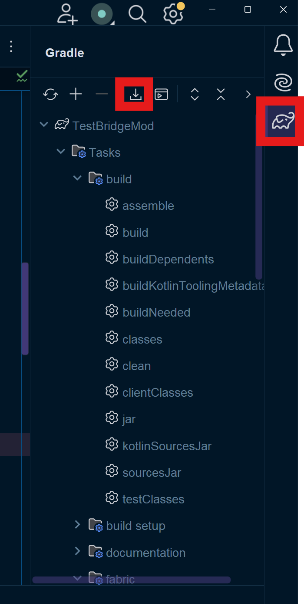

# Setting up the True Adaptive Music API

!!! warning

    Bridge mods should only be written in Kotlin.

Implementing either modded predicates or events (or both) requires creating a **Bridge Mod**. That is, a mod that "bridges" the functionalities of two mods. If you have any questions about it, I would recommend asking in the discord. If you are the creator of the mod you want to make the bridge for, you could also just follow the steps below as an integration (similar to adding ModMenu support) directly into your mod.

First, make a new mod (or open up your existing mod project if you are the mod owner). I personally recommend using the Minecraft Development plugin with Intellij as it makes the boilerplate steps very easy. However you do it, you'll want to make a mod for the Minecraft version you are using and for fabric.

Once your environment is loaded, you'll want to get either the gradle reference for the True Adaptive Music API mod, which can be added to your build file dependencies with the below snippet.

```kt
// For unofficial mappings on fabric (<26.1)
modApi("io.github.liltojustice:TrueAdaptiveMusicAPI-MODLOADER_HERE-MC_TARGET_HERE:TAM_API_VERSION_HERE")

// For official mappings/forge (>=26.1)
api("io.github.liltojustice:TrueAdaptiveMusicAPI-MODLOADER_HERE-MC_TARGET_HERE:TAM_API_VERSION_HERE")
```

Replace `MODLOADER_HERE` with the modloader you're developing on. Can be `fabric`, `forge`, or `neoforge` with the same version compatibility as the base True Adaptive Music mod.

Replace `MC_TARGET_HERE` with the **highest version below** the version you are developing from [this list](https://github.com/LilTOJustice/TrueAdaptiveMusicAPI/branches/all?query=versions%2F). E.g. if developing for 26.2, use 26.1. If developing for 1.21.6, use 1.21.1.

Then replace `TAM_API_VERSION_HERE` with the latest version, which can be found by looking at the `mod_version` field at https://github.com/LilTOJustice/TrueAdaptiveMusicAPI/blob/versions/MC_TARGET_HERE/gradle.properties. 

**Replace `MC_TARGET_HERE` in the above link with the same version you just found.**

Finally make sure to download sources for gradle and you're good to go! In IntelliJ this can be done by opening the gradle window and clicking the download icon:


After that task finishes, you're ready to create your custom [predicates](Creating%20a%20Predicate%20Type.md) or [events](Creating%20an%20Event%20Type.md)!

If you are creating an event, I would still recommend reading the predicate tutorial first, as events are similar but general more complicated to implement.